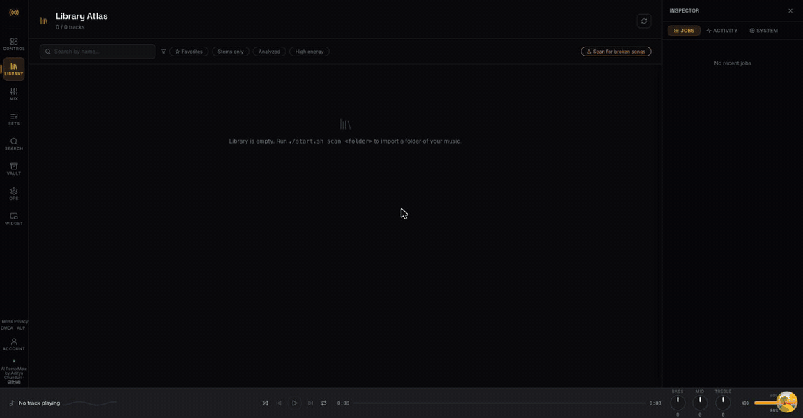
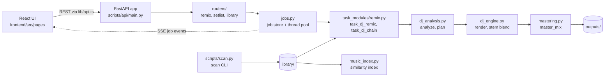

# AI RemixMate

A local DJ transition and set renderer: point it at a folder of your own music, pick two songs, and it renders a beat matched, key aware transition between them, or a continuous mix of up to eight.

  [](https://github.com/Chunduri-Aditya/ai-remixmate/actions/workflows/ci.yml)

The audio engine and API are Python (FastAPI, librosa, Demucs). The web UI is React, Vite and TypeScript. Rendering and analysis run on your machine.



*Silent recording of the real app. It opens on an empty library. Between the first two scenes, `./start.sh scan "My Music" --stems --analyze` ran in a terminal on a folder of two CC0 tracks ("Cusps" and "Test Flight" by Joel Putman, from the Internet Archive). The rest shows the library filled, both tracks loaded in Mix Deck, a 16 bar render and playback. Frames are shown at a fixed pace, so the render looks faster than its real 1 minute 16 seconds.*

---

## Quick start

Requirements: Python 3.12, Node 22, ffmpeg (Docker is optional). On macOS: `brew install python@3.12 node@22 ffmpeg`; `node@22` needs a PATH line, see [PREREQUISITES.md](PREREQUISITES.md).

```bash
git clone https://github.com/Chunduri-Aditya/ai-remixmate.git && cd ai-remixmate
./start.sh setup
./start.sh
```

`./start.sh setup` creates `.venv`, installs the Python packages (runtime and test, including torch and Demucs, a large download) and the npm packages. `./start.sh` then starts the API and the React UI and opens the UI in your browser unless you pass `--no-open`. It installs again only when packages are missing or the dependency files changed. The library starts empty: add songs with `./start.sh scan <folder>` (see "Add your music"). Rendered mixes are deleted after 30 days or beyond 50 mixes, so copy any you want to keep. Test commands are in the Tests section.

Ports: `REMIXMATE_API_PORT` (default 8000) and `REMIXMATE_UI_PORT` (default 5173) move the two servers, for example `REMIXMATE_API_PORT=8765 REMIXMATE_UI_PORT=5199 ./start.sh`. Use the same variables with `./start.sh stop`. `start.sh` stops only its own listeners and exits when another program holds a port.

Other modes (from `start.sh`):

```bash
./start.sh api                # API only, on http://127.0.0.1:8000
./start.sh --skip-setup       # start without checking packages (run ./start.sh setup once first)
./start.sh --no-open          # do not open the browser
./start.sh --dev              # API with --reload
./start.sh stop               # stop this app's API and UI listeners
```

The API binds to `127.0.0.1` by default. Then open:

- React UI: <http://localhost:5173>
- Floating DJ widget: <http://localhost:5173/widget>
- API reference (Swagger UI): <http://127.0.0.1:8000/docs>, with ReDoc at `/redoc`

Docker runs the API only (no React UI) on `127.0.0.1:8000`, with `library/` mounted read only. Not tested for this release:

```bash
docker compose up
```

---

## Add your music

```bash
./start.sh scan ~/Music/my-set                  # same as: .venv/bin/python -m scripts.scan <folder>
./start.sh scan ~/Music/my-set --stems          # also split stems with Demucs
./start.sh scan ~/Music/my-set --analyze        # also run tempo, key and structure analysis
```

Each `mp3`, `flac`, `wav`, `m4a`, `ogg` or `aiff` file under the folder (searched recursively; hidden files and dot folders are skipped) becomes `library/<name>/full.wav`, mono at 44.1 kHz, converted with ffmpeg. The name is the file name without its extension. Non ASCII names such as "Café del Mar" are kept.

- `--stems` runs Demucs and writes `vocals.wav`, `drums.wav`, `bass.wav` and `other.wav` beside `full.wav`. The first run downloads the `htdemucs` weights (one 84.1 MB checkpoint file) into the torch cache. One measured run: a 2:46 CC0 MP3 took 37.4 s wall on an Apple Silicon Mac. Stems are optional. Without them the engine renders the transition on the full mixes, with no stem blend.
- `--analyze` runs the song analysis (tempo, key, structure) and caches `meta.json` and `analysis.json`, which the library views, recommendations and setlist planning read. A render analyses the loaded audio fresh either way.
- A rescan skips songs already present. A song whose `full.wav` or any stem already exists is reported as "already in library" and is not converted again. Scan compares names, not contents, so a different file with the same name also reads as already present.
- A file that fails to convert is reported on one line and the scan continues.
- Exit codes: `0` every file imported or already present; `1` no audio files found, or some files skipped or failed; `2` the folder does not exist or ffmpeg is not on `PATH`.

Your files stay where they are. Scan reads them and writes copies under `library/`. Hosted mode is built to serve the catalog, not `library/`.

### Alternative: Creative Commons catalog ingest

`scripts.download` pulls Creative Commons or public domain tracks from ccMixter or the Internet Archive, classifies the licence, separates stems and runs analysis:

```bash
.venv/bin/python -m scripts.download --source ccmixter "glitch hop" --search-only
REMIXMATE_LICENSE_ENFORCE=1 .venv/bin/python -m scripts.download --source ccmixter "glitch hop" --pick 2
```

With `REMIXMATE_LICENSE_ENFORCE=1` the licence gate rejects tracks that are not CC0, public domain or CC BY. `--help` lists every option.

---

## What it does

1. **A transition between two songs.** Pick Song A and Song B in the UI. The app renders the end of A into the start of B as a background job and plays the result (`POST /dj-remix`). A preview of just the transition window is available (`POST /dj-remix/preview`).
2. **A set of 2 to 8 songs.** In Set Builder, choose the songs and render one continuous mix with a transition at every join (`POST /dj-chain`). Set renders are mastered quieter than single transitions, see Limits.
3. **Auto sequence.** In Set Builder, "Auto-sequence" orders the songs you chose by harmonic fit, tempo and energy cost (`scripts/core/setlist_planner.py`). It orders a set you picked. It does not build a mix from the whole library unattended.

Around the renderer: library search and crates, recommendations, Camelot key change classification (`/setlist/camelot/modulation`), a thumbs up or down on a render that tunes the cue matching weights (`POST /dj-remix/feedback`), job progress over server sent events, and a floating DJ widget at `/widget`. Interactive API docs are at <http://127.0.0.1:8000/docs>.

---

## How the mixing works

The live engine is `scripts/core/dj_engine.py` with its planner in `scripts/core/dj_analysis.py`. These steps describe the `current` engine, which `config.yaml` selects with `dj.mixing_engine: current`; `classic` runs the frozen engine in `scripts/core/classic_engine/` and masters to -8 LUFS. A `POST /dj-remix` runs these steps in `scripts/api/task_modules/remix.py::task_dj_remix`. Function level detail is in [docs/agents/MIXING_MAP.md](docs/agents/MIXING_MAP.md) and the music theory is in [docs/DJ_THEORY.md](docs/DJ_THEORY.md).

1. **Load.** `scripts/core/audio_source.py::load_source_audio` reads `full.wav` (falling back to `full_enhanced.wav`, then to the sum of the stems) as mono 44.1 kHz, capped at `remix.max_song_seconds` (180 s in `config.yaml`).
2. **Beat and bar grid.** `scripts/core/dj_analysis.py::analyze_structure` runs a beat tracker (`scripts/core/beat_tracker.py`): Beat This when that package is installed, librosa otherwise (with the default `analysis.beat_backend` of `auto`). Bars are groups of four beats counted from the first detected beat.
3. **Tempo.** On the librosa backend, `refine_bpm_from_beats` first replaces the coarse tempo with the mean of the inlier beat intervals (it keeps the coarse tempo when the intervals are too ragged). `resolve_bpm_octave` then picks between that tempo and its double or half using onset autocorrelation weighted by a prior centred on 122 BPM, searching a 70 to 180 range. The Beat This backend takes the median beat interval and runs only the octave step.
4. **Sections and phrases.** `analyze_structure` labels each stretch as intro, verse, build, drop, chorus, break or outro from per bar loudness and brightness. It finds phrase boundaries from a chroma self similarity matrix and snaps them to the bar grid.
5. **Key and compatibility.** `scripts/core/key_detection.py::detect_key` estimates the key by Krumhansl style correlation and maps it to a Camelot code (A minor is 8A, C major is 8B). `plan_transition` scores the harmonic fit of the two keys. `pitch_shift_for_camelot` returns 0 when the keys are compatible and otherwise the smallest shift of up to 3 semitones that makes Song B compatible with A (0 if none fits). Only the stem blend path applies it, and it transposes all of Song B's stems and its full mix.
6. **Cue points.** `plan_transition` picks an exit point in A and an entry point in B at phrase boundaries, so the window starts where a phrase starts. The default length is 16 bars, or 8 when the two tempos differ by more than 8 percent. When the harmonic score is under 0.35 and the window is 16 bars or longer, it is cut to 8. With `dj.spectral_matching` on, `scripts/core/spectral_matching.py::choose_entry_bar` may move B's entry bar to the phrase start whose spectrum best follows A's outro, weighted by how well B's drop lines up with the window.
7. **Tempo match.** `scripts/core/dj_engine.py::_time_stretch` stretches only Song B by `bpm_a / bpm_b` with a phase vocoder (librosa on CPU, torchaudio when a GPU device is selected). The ratio is clamped to 0.5 to 2.0 and skipped when it is within 0.02 of 1.
8. **Bar grid phase.** B is shifted by the phase difference between the two bar grids, wrapped to half a bar either way, with the aim of landing the downbeats together. This step has a known defect; see [Known issues](#known-issues).
9. **Pick a render path.** `scripts/api/task_modules/remix.py::_should_use_stem_blend` uses the stem blend when both songs have stem files and the transition confidence is at or above `dj.transition_confidence_threshold` (0.30). Confidence is the average of the harmonic score and the spectral cue match score, or the harmonic score alone when there is no spectral score. Otherwise `DJEngine.render` does the transition on the full mixes.
10. **Blend.** `DJEngine.render_stem_blend` fades each stem on its own curve, chosen by how similar that stem pair is: a hold then fade for pairs with similarity of 0.75 or more (Song A's last 2 bars loop under the fade), an equal power curve from 0.40 to 0.75, and a handoff below 0.40 where A fades out over the first half and B fades in over the second. The `stepped` effect uses one plateau per beat. A masking aware EQ (`scripts/core/spectral_mixing.py::unmask_stem_pair`) ducks bands where one side covers the other. By default `DJEngine.render` instead applies an exit effect to A (a low pass sweep when the harmonic score is under 0.35, an echo otherwise) and a three band fade over the second half of the window.
11. **Bass swap.** The bass does not play from both songs at once. At the middle of the window (`bass_swap_bar`) A's bass tapers out over the 100 ms before it and B's bass tapers in over the 100 ms after it, both on a cosine curve (`_stem_bass_ramp`). `bass_swap_bar` is `transition_bars // 2`. The non stem path high passes A at 150 Hz from the same point.
12. **Bridge beat.** Optionally `scripts/core/beat_synth.py::render_beat` synthesizes a drum loop (genre presets such as `techno`, `house`, `hiphop`) at A's tempo and lays it under the window with a sine shaped level. No sample files are used.
13. **Spectral sync.** `scripts/core/spectral_sync.py::apply_spectral_sync` eases the mix spectrum from A's toward B's profile across the window, with gain capped at `dj.spectral_sync_max_db`.
14. **Mastering.** `scripts/core/mastering.py::master_mix` normalizes to `audio.target_lufs` (-14), runs a true peak limiter (`apply_limiter`: 4x oversampled look ahead, ceiling -1 dBFS), then measures again and runs up to 3 make up gain passes (0.3 LU tolerance), because limiting lowers loudness.
15. **Write.** The mix is saved as a 24 bit WAV with `CREDITS.txt` and `manifest.json` under `outputs/<user>/dj_<id>/`.

Set ordering (`scripts/core/setlist_planner.py::transition_cost`) scores each possible join as 0.50 harmonic, 0.30 tempo and 0.20 energy, and a greedy search orders the set by that cost.

### Worked example: 120 BPM into 124 BPM

Two click tracks, one at 120 BPM and one at 124, are scanned. The tracker reads them as 120.0 and 124.0. The stretch ratio is 120 / 124, about 0.968, so B is slowed by about 3 percent to sit on A's grid. That is farther than 0.02 from 1, so the stretch runs. A `POST /dj-remix` render of the pair came out at 105.98 s against a planned 106 s, at -14.06 LUFS integrated against the -14 target, with true peak at or under -1.0 dBTP. A mix of real CC0 music measured -14.39 LUFS once, which no test covers. The click track test `tests/test_scan_mix_e2e.py` asserts tempos within 1 BPM of 120 and 124, length within 1 s of the plan and loudness within 1 LU of the target. The exact readings and the true peak above come from a separate probe run and are not asserted by the test.

---

## Architecture



- `scripts/api/`: the FastAPI app. `main.py` wires middleware, `jobs.py` holds the job store and worker pool, `routers/` has one file per area, `task_modules/` holds the job bodies.
- `scripts/core/`: the engine and stores. Analysis (`dj_analysis.py`, `beat_tracker.py`, `key_detection.py`), rendering (`dj_engine.py`, `spectral_matching.py`, `spectral_sync.py`), `mastering.py`, `stems.py`, `setlist_planner.py` and the library and index code.
- `scripts/scan.py` and `scripts/download.py`: the two ways songs enter the library.
- `frontend/src/`: `pages/`, `shell/`, `lib/` (API client, player), `hooks/` (SSE), `stores/`.
- `tests/`: the pytest suite. Frontend tests sit in `__tests__` folders under `frontend/src/`.
- `app/`: the hosted mode plan, status and deploy files.
- `scripts/core/classic_engine/`: a frozen earlier engine, selectable with `dj.mixing_engine`. `archive/` is history.

Runtime directories are gitignored: `library/` (songs and stems), `outputs/` (renders), `data/` (SQLite stores), `models/`. The full module walk is in [ARCHITECTURE.md](ARCHITECTURE.md).

---

## Tests

```bash
# Python, from the repo root
.venv/bin/python -m pytest -m "not dj_analysis" --ignore=tests/e2e_test_suite.py -q
.venv/bin/python -m pytest -m dj_analysis -q
.venv/bin/ruff check .

# Frontend, from frontend/
npx tsc --noEmit
npx vitest run
npx eslint . --max-warnings 0
npx vite build
```

At commit `c5bc599` the Python CI subset passed 1,966 tests (1 skipped), the `dj_analysis` group 108 and vitest 144, locally and in CI. Counts shift as tests are added, so run the commands for the current number.

`tests/test_scan_mix_e2e.py` is the end to end check. It scans two synthetic click tracks at 120 and 124 BPM into an isolated library, confirms the tempos read within 1 BPM of 120 and 124, renders them through `POST /dj-remix`, and asserts that the mix file exists, its length is within 1 s of the plan, and its loudness is within 1 LU of the target. It also checks that a wrong tempo fails the tempo gate. Tests point the data and outputs folders at a throwaway directory, so a test run does not write into your real `outputs/` or `data/`.

---

## Configuration

`config.yaml` holds the tunable parameters. Override values in a local `config.local.yaml` (gitignored), or with environment variables named `REMIXMATE_<SECTION>_<KEY>` (for example `REMIXMATE_AUDIO_SAMPLE_RATE`). Environment variables win over both files. Keys you may want:

```yaml
audio:
  target_lufs: -14.0
remix:
  max_song_seconds: 180
dj:
  default_transition_bars: 16
  masking_eq_enabled: true
  spectral_matching: true
  spectral_sync: true
  transition_confidence_threshold: 0.30
retention:
  mix_max_age_days: 30
  mix_max_count: 50
```

Rendered mixes are not permanent: the retention sweep deletes old sessions after each render and on a timer, using the `retention` keys. Set `REMIXMATE_DEVICE=cpu|mps|cuda` to force the Demucs device. Comments in `config.yaml` describe most keys.

---

## Limits

- No real time playback or DJ deck control. It renders files and plays the finished result.
- Demucs is slow on CPU. Stems are optional for that reason.
- Stems are loudness normalised per stem by design, so they do not sum back to `full.wav`.
- Set renders (`POST /dj-chain`) master to a fixed -8 LUFS that the -1 dBTP ceiling cannot reach. They land about 2.8 LU short of it. Single transitions use the -14 target from `config.yaml`.
- The library index has no lock against a scan running while the API writes to it. Do not scan while the API is busy.
- Auto sequence orders songs you picked. It does not generate a mix from the whole library.
- Hosted multi user mode is built in code but not deployed.

## Known issues

- Song B can enter up to half a bar off song A's downbeat, because the bar phase correction measures each cue from the start of its file instead of from the beat grid (MX-03).

The full list, with severity and fix sketches, is in [docs/agents/BACKLOG.md](docs/agents/BACKLOG.md).

---

## Hosted mode

A multi user mode (Supabase auth, Postgres, a CC licensed catalog) is built in code under [`app/`](app/) but is not deployed. Current state and open gaps are in [`app/STATUS.md`](app/STATUS.md).

---

## Legal

Catalog ingest admits only CC0, public domain and CC BY tracks (`scripts/core/license.py`), enforced with `REMIXMATE_LICENSE_ENFORCE=1`. Each catalog song keeps a `license.json`, and rendered mixes carry a `CREDITS.txt`. Your own music stays on your machine, and hosted mode is built to serve the catalog, not `library/`.

---

## License and credits

MIT, see [LICENSE](LICENSE). Built by [Aditya Chunduri](https://github.com/Chunduri-Aditya). Use "Cite this repository" on GitHub, which reads `CITATION.cff`. Release history is in [CHANGELOG.md](CHANGELOG.md).
