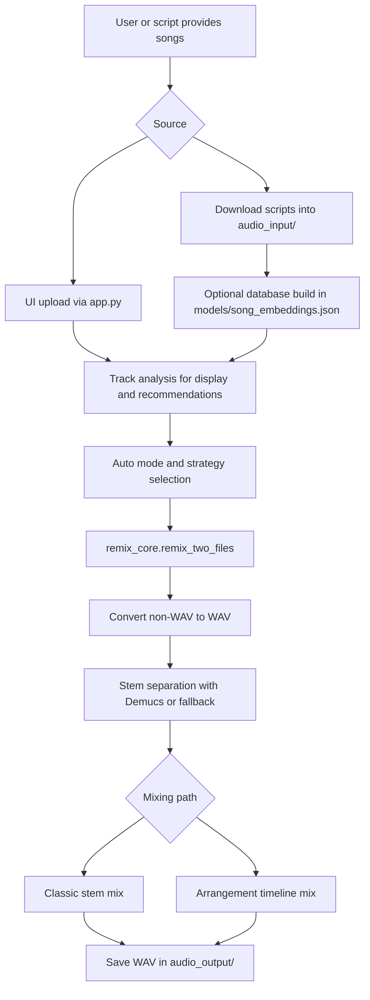

# AI RemixMate Working Architecture

Status: generated from the current repository files on 2026-06-12.

This document maps the project from start to finish: song ingestion, optional song database creation, stem separation, track analysis, remix planning, rendering, UI flow, scripts, libraries, and testing/connectivity checks. It also calls out which parts are connected today and which parts exist as standalone helpers or planned/experimental work.

## 1. Project Goal

AI RemixMate is a local Python audio remixing toolkit with a Gradio UI. The intended user journey is:

1. Bring in songs, either by upload in the UI or by downloading into `audio_input/` with scripts.
2. Analyze the tracks for BPM, key, genre, energy, and danceability.
3. Split songs into stems: vocals, drums, bass, and other.
4. Choose a remix strategy automatically or manually.
5. Mix stems using classic stem-combination logic or arrangement-level timeline logic.
6. Save a final WAV remix under `audio_output/`.

The codebase currently supports two main remix paths:

- Classic mixing: direct stem selection, volume balancing, optional beatmatching/harmonic shifting, and simple end fade.
- Arrangement mixing: section detection, timeline planning, clip rendering, beatmatching in the renderer, fades, and limited effects.

## 2. High-Level Pipeline



## 3. Runtime Entry Points

### Web UI

Primary command:

```bash
python app.py
```

`app.py` checks the Python version and required imports, then starts a Gradio app at port `7860`. It does not install dependencies automatically.

UI tabs:

- `Remix Creator`: upload two audio files, analyze them, choose remix settings, generate remix.
- `Playlist Manager`: create/delete playlists and add/remove songs stored in `models/user_playlists.json`.

Important UI functions:

- `analyze_track1(file)`: analyzes track 1 and asks the recommendation system for compatible songs.
- `analyze_track2(file)`: analyzes track 2.
- `remix_files(...)`: maps UI choices into `remix_core.remix_two_files(...)`.
- `toggle_arrangement_controls(use_arrangement)`: shows/hides the parent arrangement controls row.

### Command-Line Scripts

The `scripts/` tree contains standalone workflows:

- Ingestion/download scripts.
- Database creation scripts.
- Batch Demucs stem separation.
- Lyrics extraction.
- Similarity analysis.
- Script-based remix generation from already-separated stems.
- Static code review script.

These are not exposed through the Gradio UI today except indirectly through shared files such as `audio_input/`, `separated/`, `lyrics/`, and `models/song_embeddings.json`.

## 4. Directory Responsibilities

| Path | Responsibility |
| --- | --- |
| `app.py` | Main Gradio web application and dependency checker. |
| `src/remixmate/` | Core importable package used by the UI and tests. |
| `scripts/ingestion/` | YouTube/CSV/playlist download workflows using `yt-dlp`. |
| `scripts/database/` | Song feature database builders for recommendations. |
| `scripts/audio_processing/` | Batch Demucs and Whisper lyrics extraction utilities. |
| `scripts/analysis/` | Feature inspection and similarity matching utilities. |
| `scripts/remixing/` | CLI remix helpers using pre-separated stems. |
| `tests/` | Scaffold and audio-shape regression tests. |
| `audio_input/` | Local input songs, normally gitignored except `.gitkeep`. |
| `audio_output/` | App-generated final remixes. |
| `separated/` | Demucs output, typically `separated/htdemucs/<song>/`. |
| `stems/` | Reserved stem workspace; not heavily used by current code. |
| `lyrics/` | Lyrics output for some scripts. |
| `models/` | Song database, playlists, ML model files, user preferences. |
| `output/` | Script-based remix output from `scripts/remixing/`. |
| `temp/converted/` | Auto-created by config for converted WAV files. |

## 5. Dependencies And Libraries

Declared in `pyproject.toml`:

| Group | Packages | Purpose |
| --- | --- | --- |
| Core | `numpy`, `scipy`, `librosa`, `soundfile`, `pydub`, `tqdm`, `requests`, `scikit-learn` | Audio arrays, DSP, file IO, feature extraction, progress bars, ML utilities. |
| Web | `gradio`, `fastapi`, `pydantic` | Web app. The app directly uses Gradio; FastAPI/Pydantic are supporting web-stack dependencies. |
| Separation | `demucs`, `torch` | Stem separation. Demucs uses Torch models. |
| Lyrics | `openai-whisper`, `SpeechRecognition`, `pocketsphinx` | Transcription fallback chain. |
| Ingestion | `yt-dlp` | Download audio from YouTube/YouTube Music/search. |
| Analysis | `sentence-transformers` | Lyrics embedding similarity in `scripts/analysis/analyze_similarity.py`. |
| Data | `pandas`, `numexpr`, `bottleneck` | Declared but not directly imported by current checked files. |
| Dev | `pytest` | Test runner. Existing tests use `unittest` syntax and can run under pytest or unittest. |

External tools that are effectively required for full workflows:

- `ffmpeg`: needed by `yt-dlp` audio extraction, `pydub`, and many audio conversion workflows.
- A working C/C++/Torch environment: needed for Demucs and Whisper depending on platform.

Declared but not directly used in current code paths:

- `requests`: declared, not imported in checked files.
- `pandas`, `numexpr`, `bottleneck`: declared under `data`, not imported in checked files.
- `RandomForestRegressor` and `train_test_split`: imported in `ml_audio_features.py`, not used by current functions.

## 6. Core Package File Map

### `src/remixmate/config.py`

Defines root directories and global audio constants.

Key values:

- `BASE_DIR`
- `AUDIO_INPUT_DIR`
- `AUDIO_OUTPUT_DIR`
- `SEPARATED_DIR`
- `STEMS_DIR`
- `MODELS_DIR`
- `LYRICS_DIR`
- `OUTPUT_DIR`
- `PLAYLISTS_DIR`
- `CONVERTED_DIR`
- `SAMPLE_RATE = 44100`
- `MAX_DURATION_SEC = None`

It creates all configured directories on import.

### `src/remixmate/remix_core.py`

Main orchestrator for the remix pipeline.

Important functions:

- `convert_audio_to_wav(input_path, output_path=None)`
  - Uses `librosa` first.
  - Falls back to `pydub`.
  - Writes stereo WAV at `SAMPLE_RATE`.

- `separate_stems(audio_path, output_dir=None)`
  - Uses Demucs if importable.
  - Current app path calls `demucs.separate.main([... "--mp3", "--mp3-bitrate", "320", audio_path, "-o", output_dir])`.
  - Looks for `vocals`, `drums`, `bass`, `other` in `separated/htdemucs/<track_name>/`.
  - If Demucs is unavailable or fails, returns the original audio path for every stem. This preserves pipeline connectivity but does not create true stems.

- `load_stems(stem_paths)`
  - Loads each stem with `librosa`.
  - Converts to the internal stereo shape `(samples, 2)`.

- `remix_two_files(...)`
  - Converts files.
  - Separates stems.
  - Loads stems.
  - Optionally analyzes features.
  - Optionally asks the adaptive strategy engine for mixing strategy.
  - Sends execution to either `_render_arrangement_mix(...)` or `_render_classic_mix(...)`.

- `_render_arrangement_mix(...)`
  - Loads full audio.
  - Detects sections and beat grids.
  - Optionally applies harmonic key shifting to track B stems.
  - Plans timeline using `TimelinePlanner`.
  - Renders timeline using `TimelineRenderer`.
  - Writes `audio_output/remix_arrangement.wav`.

- `_render_classic_mix(...)`
  - Optionally beatmatches track B stems.
  - Optionally harmonic-shifts track B stems.
  - Selects stems based on mode.
  - Balances volumes.
  - Applies simple technique handler: crossfade, bass swap, or quick cut.
  - Applies optional EQ/reverb/delay.
  - Peak normalizes.
  - Writes `audio_output/remix.wav`.

Current limitation: classic `bass_swap` and `quick_cut` are simplified; they combine stems without a fully developed DJ transition. Classic `crossfade` applies a fade-out to the end of the combined output, not a full two-deck overlap transition.

### `src/remixmate/dj_mixing.py`

Low-level audio and DJ helpers.

Core functions:

- `ensure_stereo(audio)`: standardizes to `(samples, 2)`.
- `to_mono(audio)`: creates analysis-friendly mono signal.
- `calculate_rms_volume(audio)`.
- `normalize_to_target_volume(audio, target_rms)`.
- `enhance_vocals(vocals_audio, boost_factor=1.5)`.
- `balance_stem_volumes(stems_dict)`.
- `create_crossfade_curve(length_samples, curve_type="linear", adaptive=True)`.
- `find_compatible_keys(key_camelot, max_semitones=2)`.
- `are_keys_compatible(key1, key2)`.
- `pitch_shift_audio(audio, semitones, sr=44100)`.
- `detect_bpm(audio, sr=44100)`.
- `estimate_key(audio, sr=44100)`.
- `time_stretch_audio(audio, rate, sr=44100)`.
- `apply_eq_filter(audio, low_cut=0.0, high_cut=1.0, sr=44100)`.
- `apply_reverb(audio, decay=0.3, sr=44100)`.
- `apply_delay(audio, delay_ms=200, feedback=0.3, sr=44100)`.

Internal audio invariant: most project mixing code expects stereo arrays shaped as `(samples, 2)`.

### `src/remixmate/structure_detection.py`

Detects musical timing and sections.

Data classes:

- `Section`: track label, section label, start/end, energy, vocal flag, bar count.
- `Phrase`: start/end and bar indexes.

Important functions:

- `detect_beat_grid(audio, sr=44100)`
  - Uses `librosa.beat.beat_track`.
  - Groups beats into bars of 4 beats.
  - Groups bars into 8-bar phrases.

- `calculate_spectral_novelty(audio, sr=44100, hop_length=512)`
  - Uses STFT spectral flux to identify change points.

- `calculate_energy_per_bar(audio, bars, sr=44100)`
  - Computes RMS for each detected bar.

- `detect_vocal_sections(audio, sr=44100)`
  - Heuristic vocal detection based on vocal-range energy and spectral centroid.

- `detect_sections(audio, sr=44100, track_label="A", vocals_audio=None)`
  - Uses beat grid, energy, novelty, and vocal hints.
  - Returns intro/verse/build/drop/break/outro style sections.
  - Provides time-based fallbacks when detection is weak.

### `src/remixmate/timeline_planner.py`

Builds an arrangement-level timeline plan.

Data classes:

- `Clip`: one stem segment from track A or B placed at a target output time.
- `ArrangementPlan`: list of clips, total duration, explanation, energy curve.

Main class:

- `TimelinePlanner`
  - `plan_arrangement(...)` chooses a template from genre.
  - EDM/electronic routes to `_edm_standard_plan(...)`.
  - Hip-hop/rap routes to `_hiphop_cut_plan(...)`.
  - Missing information routes to `_fallback_plan(...)`.

Connected advanced helper:

- Uses `EnergyCurvePlanner` from `advanced_arrangement.py`.

Current limitation:

- Beat, bar, and phrase information is accepted, but strict phrase-boundary enforcement is not wired into every transition.

### `src/remixmate/timeline_renderer.py`

Turns a timeline plan into a stereo audio buffer.

Main class:

- `TimelineRenderer(sr=44100)`
  - Pre-allocates stereo output from `plan.total_duration`.
  - Extracts source stem segments.
  - Time-stretches each track toward `target_bpm`.
  - Applies limited clip effects.
  - Applies gain, fade in, fade out.
  - Adds clip audio into the output buffer.
  - Peak normalizes if needed.

Supported clip effects today:

- `hp_filter` through `apply_eq_filter(low_cut=...)`.
- `lp_filter` through `apply_eq_filter(high_cut=...)`.

### `src/remixmate/recommendations.py`

Track analysis and compatible-song recommendation system.

Important functions:

- `analyze_track_characteristics(file_path, use_ml=True)`
  - Loads first 60 seconds.
  - Detects BPM/key.
  - Classifies genre.
  - Predicts energy and danceability.

- `analyze_track_for_display(file_path)`
  - Formats track analysis for Gradio markdown.

- `find_compatible_songs(track1_path, top_k=5)`
  - Reads `models/song_embeddings.json`.
  - Scores database songs with weights:
    - BPM: 40 percent.
    - Key: 30 percent.
    - Genre: 20 percent.
    - MFCC: 10 percent.

- `format_recommendations(recommendations)`
  - Formats recommendation output for the UI.

Connectivity:

- Connected to the UI for track analysis and recommendations.
- Recommendations require `models/song_embeddings.json`, usually created by database scripts.

### `src/remixmate/ml_audio_features.py`

Feature extraction, rule-based/ML genre and mood scoring, and adaptive strategy selection.

Important functions:

- `extract_deep_features(audio_path, sr=44100)`.
- `classify_genre(audio_path, use_ml=True)`.
- `predict_energy(audio_path)`.
- `predict_danceability(audio_path)`.
- `predict_valence(audio_path)`.
- `get_strategy_engine()`.

Main class:

- `AdaptiveRemixStrategyEngine`
  - Loads user examples from `models/ml_models/user_preferences.json`.
  - Uses a RandomForest strategy model only after enough examples exist.
  - Otherwise uses rule-based logic.
  - Predicts:
    - `technique`: `crossfade`, `bass_swap`, `quick_cut`, or `hybrid`.
    - `crossfade_length`.
    - `apply_beatmatching`.
    - `apply_harmonic_mixing`.

Connectivity:

- Connected to the UI through `app.py`.
- Connected again inside `remix_core.remix_two_files` when intelligent mixing is enabled.

### `src/remixmate/auto_mode_selector.py`

Chooses remix mode automatically.

Important functions:

- `analyze_vocal_presence(audio_path, threshold=0.05)`.
- `select_auto_mode(track1_path, track2_path)`.

Mode decisions:

- Both tracks have vocals: `mashup`.
- Track 1 has vocals only: `base_vocals_match_instr`.
- Track 2 has vocals only: `base_instr_match_vocals`.
- Neither has clear vocals: `mashup`.

Connectivity:

- Connected to the UI when dropdown value is `Auto`.

### `src/remixmate/advanced_arrangement.py`

Experimental arrangement helpers.

Connected today:

- `EnergyCurvePlanner` is used by `TimelinePlanner`.

Available but not wired into the render path today:

- `PhraseBoundaryEnforcer`.
- `CompatibilityChecker`.
- `GenreAwarePlanner`.
- `SidechainDucker`.
- `BusProcessor`.
- `TransitionFXLibrary`.

These helpers should be treated as internal experiments until they have render-path integration and tests.

### `src/remixmate/lyrics_extraction.py`

Lyrics/transcription helper with fallback chain:

1. Whisper.
2. SpeechRecognition with Google.
3. PocketSphinx through SpeechRecognition when available.

Important functions:

- `extract_lyrics_whisper(audio_path, model_size="base")`.
- `extract_lyrics_speechrecognition(audio_path)`.
- `extract_lyrics(audio_path, model_size="base", use_fallback=True)`.

Connectivity:

- Imported in `app.py`, but not exposed by the current UI.
- Separate scripts use Whisper directly.

### `src/remixmate/playlist_manager.py`

JSON-backed playlist management.

Important functions:

- `create_playlist(name, description="", user_id="default")`.
- `add_song_to_playlist(playlist_id, song_name, song_path)`.
- `remove_song_from_playlist(playlist_id, song_name, song_path)`.
- `get_playlists(user_id="default")`.
- `get_playlist(playlist_id)`.
- `get_playlist_songs(playlist_id)`.
- `delete_playlist(playlist_id)`.
- `get_available_songs()`.

Storage:

- `models/user_playlists.json`.

Connectivity:

- Connected to the Gradio `Playlist Manager` tab.
- Not currently connected to automatic remix generation from a playlist selection.

### `src/remixmate/__init__.py`

Empty package initializer. `from remixmate import config, remix_core, ...` still works because Python can import package submodules.

## 7. Script File Map

### Ingestion Scripts

#### `scripts/ingestion/download_song.py`

Purpose: download one YouTube/YouTube Music URL into `audio_input/`.

Library: `yt-dlp`.

Output format: WAV via FFmpeg postprocessor.

Connectivity:

- Standalone script.
- Output files can later be used by the UI, database builder, or batch Demucs.

#### `scripts/ingestion/download_from_csv.py`

Purpose: read a CSV and download each song by URL or search query.

Expected CSV:

- Header row is skipped.
- Column 1: title.
- Column 2: optional URL.

Library:

- Invokes `python -m yt_dlp` in a subprocess.

Output:

- `audio_input/<downloaded title>.wav`.

Connectivity:

- Standalone script.

#### `scripts/ingestion/extract_youtube_playlist.py`

Purpose: extract a playlist, skip already-downloaded songs, optionally add downloaded songs to the recommendation database.

Important functions:

- `check_song_exists(...)`.
- `check_song_in_database(...)`.
- `extract_playlist_info(playlist_url)`.
- `download_playlist_songs(...)`.
- `list_extracted_playlists()`.

Storage:

- Downloads to `audio_input/<playlist name>/`.
- Saves playlist summary to `models/playlists.json`.
- Can add features to `models/song_embeddings.json`.

Connectivity:

- Standalone script, but connects to the recommendation system through the database file.

### Database Scripts

#### `scripts/database/song_database.py`

Purpose: add one song to the local feature database.

Features:

- Tempo.
- Chroma.
- MFCC.

Storage:

- `models/song_embeddings.json`.

Connectivity:

- Used by `extract_youtube_playlist.py` through `_add_song_to_database(...)`.
- Database is used by `src/remixmate/recommendations.py`.

#### `scripts/database/batch_add_to_database.py`

Purpose: scan `audio_input/` recursively and add all audio files to `models/song_embeddings.json`.

Features:

- Tempo.
- Chroma.
- MFCC.
- Source path.

Connectivity:

- Standalone script.
- Its output feeds UI recommendations.

### Audio Processing Scripts

#### `scripts/audio_processing/batch_demucs.py`

Purpose: split all WAV files directly under `audio_input/`.

Command used:

```bash
python -m demucs -n htdemucs -o separated <song.wav>
```

Expected output:

```text
separated/htdemucs/<song>/
  vocals.wav
  drums.wav
  bass.wav
  other.wav
```

Connectivity:

- Standalone batch separation path.
- Its outputs are used by lyrics extraction and CLI remix scripts.
- The app does its own on-demand separation inside `remix_core.separate_stems`.

#### `scripts/audio_processing/extract_lyrics.py`

Purpose: transcribe one vocals stem with Whisper and timestamps.

Input:

- Usually `separated/htdemucs/<song>/vocals.wav`.

Output:

- `lyrics/<song>_lyrics.txt`.

Connectivity:

- Standalone script.

#### `scripts/audio_processing/batch_extract_lyrics.py`

Purpose: transcribe every `vocals.wav` under `separated/htdemucs/<song>/`.

Output:

- `separated/htdemucs/<song>/lyrics.txt`.

Connectivity:

- Feeds `scripts/analysis/analyze_similarity.py`, which expects lyrics beside stems.

### Analysis Scripts

#### `scripts/analysis/analyze_features.py`

Purpose: print tempo, average chroma, and average MFCC for one audio file.

Connectivity:

- Standalone diagnostic.

#### `scripts/analysis/recommend_match.py`

Purpose: compare one song against `models/song_embeddings.json` using cosine similarity over MFCC + chroma.

Connectivity:

- Standalone recommendation CLI.
- Uses the same database file as UI recommendations, but scoring logic is different from `src/remixmate/recommendations.py`.

#### `scripts/analysis/analyze_similarity.py`

Purpose: find best separated-song matches using lyrics embeddings, audio MFCC distance, and tempo similarity.

Requirements:

- `sentence-transformers`.
- `separated/htdemucs/<song>/other.wav`.
- `separated/htdemucs/<song>/lyrics.txt`.

Scoring:

- Lyrics embedding similarity: 50 percent.
- Audio MFCC score: 30 percent.
- Tempo score: 20 percent.

Connectivity:

- Used by `scripts/remixing/remix_from_match.py` and `scripts/remixing/smart_remix.py`.

### Remixing Scripts

#### `scripts/remixing/remix_from_match.py`

Purpose: choose a compatible separated song, then combine vocals from one song with instruments from another.

Important functions:

- `get_available_songs(...)`.
- `load_stem(song, stem_name, ...)`.
- `generate_smooth_remix(vocal_song, instrumental_song)`.
- `resolve_song_name(input_name)`.
- `main(base_input)`.

Output:

- `output/remix_<vocal_song>_<instrumental_song>.wav`.

Connectivity:

- Uses `scripts.analysis.analyze_similarity.find_best_match`.
- Requires pre-existing Demucs stems.
- Does not use the main `src/remixmate/remix_core.py` pipeline.

#### `scripts/remixing/smart_remix.py`

Purpose: wrapper around similarity matching and smooth remix generation.

Command:

```bash
python scripts/remixing/smart_remix.py --base "<song folder name>"
```

Connectivity:

- Uses `find_best_match`, `resolve_song_name`, and `generate_smooth_remix`.
- Requires separated stems and optional lyrics.

### Maintenance Script

#### `scripts/code_review.py`

Purpose: basic import/function/file structure check.

Checks:

- Core modules import.
- Critical functions exist.
- Required files exist.
- Optional database warning.
- App uses package imports.
- Config constants exist.

Connectivity:

- Good static smoke check before deeper tests.

## 8. Downloading Songs

Current download capabilities are script-only, not UI-connected.

Single-song path:

```bash
python scripts/ingestion/download_song.py
```

CSV path:

```bash
python scripts/ingestion/download_from_csv.py
```

Playlist path:

```bash
python scripts/ingestion/extract_youtube_playlist.py
```

Recommended full ingestion flow:

1. Install ingestion dependencies:

```bash
python -m pip install -e ".[ingestion]"
```

2. Confirm `ffmpeg` is installed and visible on PATH.
3. Download legally usable songs into `audio_input/`.
4. Build the recommendation database:

```bash
python scripts/database/batch_add_to_database.py
```

5. Optionally split stems:

```bash
python scripts/audio_processing/batch_demucs.py
```

Current gap:

- The Gradio UI does not include a URL downloader.
- The UI only accepts uploaded files through Gradio file inputs.

## 9. Stem Separation

Current primary method: Demucs.

User-friendly explanation:

Demucs is a machine-learning model that listens to a full song and estimates separate audio tracks called stems. In this project the target stems are:

- `vocals`: singing/rapping/lead voice.
- `drums`: kick, snare, hats, percussion.
- `bass`: bass line and low-frequency musical content.
- `other`: remaining instruments such as synths, guitar, keys, pads.

The main app uses on-demand separation inside `src/remixmate/remix_core.py`.

The batch workflow uses:

```bash
python scripts/audio_processing/batch_demucs.py
```

Expected app path behavior:

1. Convert input to WAV if needed.
2. Call Demucs.
3. Load generated stems.
4. Continue to remixing.

Fallback behavior:

- If Demucs is not installed or fails, the core returns the original full track as every stem.
- This keeps the app from crashing, but the output is not a real vocal/instrumental split.

Smarter future separation options:

- Cache Demucs results by input file hash to avoid re-separating the same song.
- Let experienced users choose Demucs model variants such as `htdemucs`, `htdemucs_ft`, or `mdx_extra`.
- Use shorter previews for fast experimentation, full separation for final rendering.
- Detect whether GPU is available and show expected speed.
- Add a clear UI state: "True stems available" vs "fallback full-song stems".

## 10. Mixing Modes And Logic

### UI Modes

Current dropdown values:

- `Auto (Recommended)`.
- `Mashup (Mix Both Tracks)`.
- `Track 1 Vocals + Track 2 Instruments`.
- `Track 1 Instruments + Track 2 Vocals`.

Current toggles:

- `Intelligent Mix (Recommended)`.
- `Arrangement-Level Mixing`.

Arrangement controls:

- `Remix Aggressiveness`: 0.0 to 1.0.
- `Energy Shape`: `chill_to_peak`, `rollercoaster`, `slow_build`, `double_peak`.

Suggested user-level mode architecture:

| User mode | What the user sees | Internal defaults |
| --- | --- | --- |
| Easy | Upload two songs and click Create Remix. | Auto mode, intelligent mix on, safe crossfade, hidden advanced settings. |
| Guided | Shows remix type, intelligent toggle, arrangement toggle, energy shape. | Current UI is close to this. |
| Experienced | Shows BPM/key handling, crossfade curve, Demucs model, cache controls, EQ/effects, output naming. | Mostly not exposed today, though many lower-level parameters exist in `remix_core.remix_two_files`. |

### Classic Mixing Path

Connected from UI when `Arrangement-Level Mixing` is off.

Pipeline:

```text
remix_files -> remix_core.remix_two_files -> _render_classic_mix
```

Algorithm:

1. Optionally beatmatch track B stems toward track A BPM.
2. Optionally harmonic-shift track B stems toward track A key.
3. Select stems based on mode:
   - Mashup: average matching stems from both songs.
   - Track 1 vocals + track 2 instruments.
   - Track 1 instruments + track 2 vocals.
4. Balance stem volumes:
   - Normalize stems toward average RMS.
   - Boost vocals by 1.5x.
   - Reduce non-vocal stems by 0.7x.
5. Apply selected technique:
   - `crossfade`: combines stems and fades the end.
   - `bass_swap`: currently simplified, combines stems.
   - `quick_cut`: currently simplified, combines stems.
6. Apply optional EQ/reverb/delay.
7. Peak normalize.
8. Save `audio_output/remix.wav`.

Connectivity status:

- Connected to UI.
- Beatmatching connected.
- Harmonic shifting connected when strategy enables it.
- Bass swap and quick cut names are connected, but implementation is simplified.

### Arrangement Mixing Path

Connected from UI when `Arrangement-Level Mixing` is on.

Pipeline:

```text
remix_files -> remix_core.remix_two_files -> _render_arrangement_mix
  -> detect_sections
  -> detect_beat_grid
  -> TimelinePlanner.plan_arrangement
  -> TimelineRenderer.render_timeline
```

Algorithm:

1. Load full audio for both tracks.
2. Detect sections for each track.
3. Detect beat grids for each track.
4. Analyze track 1 genre.
5. Generate an energy curve.
6. Select a genre-aware plan:
   - EDM/electronic/techno: intro/build/drop/transition/drop/outro style.
   - Hip-hop/rap: verse to quick-cut/drop style.
   - Other: EDM fallback.
7. Render clips from stems onto an output timeline.
8. Time-stretch clips toward target BPM.
9. Apply clip-level fades, gain, and limited filters.
10. Peak normalize.
11. Save `audio_output/remix_arrangement.wav`.

Connectivity status:

- Connected to UI.
- Energy curves connected.
- Timeline clips connected.
- Phrase-boundary enforcement not fully connected.
- Advanced sidechain/bus/transition helpers not connected.

## 11. Recommendations And Song Database

UI recommendation flow:

```text
Upload track 1 -> analyze_track1 -> find_compatible_songs -> models/song_embeddings.json
```

Database creation flow:

```bash
python scripts/database/batch_add_to_database.py
```

The database stores features per song. Current database builders store:

- Tempo.
- Chroma vector.
- MFCC vector.
- Path, in the batch builder.

Recommendation scoring in `src/remixmate/recommendations.py`:

- BPM similarity.
- Camelot key compatibility.
- Genre match.
- MFCC similarity.

Current limitation:

- Database scripts do not store key or genre, so recommendation code falls back to default key/genre when those fields are missing. This means the UI recommendation score may be less informed than intended unless the database schema is expanded.

## 12. Lyrics And Similarity

There are two lyrics-related paths:

1. Core package helper: `src/remixmate/lyrics_extraction.py`.
2. CLI scripts: `scripts/audio_processing/extract_lyrics.py` and `batch_extract_lyrics.py`.

The similarity-based CLI remix path expects:

```text
separated/htdemucs/<song>/other.wav
separated/htdemucs/<song>/lyrics.txt
```

Then:

```bash
python scripts/analysis/analyze_similarity.py "<song folder name>"
python scripts/remixing/smart_remix.py --base "<song folder name>"
```

Connectivity status:

- Lyrics are not connected to main Gradio remix generation.
- Lyrics are connected to CLI similarity matching and script-based remixing.

## 13. Current Connected Vs Not Connected Matrix

| Capability | Connected to UI? | Connected elsewhere? | Notes |
| --- | --- | --- | --- |
| Upload two files | Yes | N/A | Main UI path. |
| Download songs | No | Yes | Script-only via `yt-dlp`. |
| YouTube playlist extraction | No | Yes | Script-only; can add to DB. |
| Demucs separation | Yes | Yes | App on-demand plus batch script. |
| Demucs fallback | Yes | N/A | Uses original audio as all stems if unavailable. |
| Track analysis | Yes | Yes | UI plus scripts. |
| Recommendations | Yes | Yes | Requires database file. |
| Playlist management | Yes | N/A | UI tab stores JSON playlists. |
| Playlist-driven remixing | No | No | Playlist tab does not launch remixes. |
| Auto remix mode | Yes | N/A | UI dropdown routes to auto selector. |
| Intelligent strategy | Yes | N/A | Rule-based unless enough examples exist. |
| Classic remix | Yes | Yes | Core path and tests cover helpers. |
| Arrangement remix | Yes | N/A | Core path. |
| Energy curves | Yes | N/A | Used by timeline planner. |
| Phrase enforcement | No | Helper exists | Not broadly wired into planner/rendering. |
| Sidechain ducking | No | Helper exists | Experimental. |
| Bus processing | No | Helper exists | Experimental. |
| Transition FX library | No | Helper exists | Experimental. |
| Lyrics extraction | No | Yes | Script path and package helper. |
| Similarity remix | No | Yes | Separate CLI path, not `remix_core`. |
| LUFS normalization | No | No | Peak normalization only. |
| Stem/analysis cache | No | No | Planned need. |

## 14. Testing And Connectivity Plan

### Install For Full Local Testing

```bash
python3 -m venv .venv
source .venv/bin/activate
python -m pip install --upgrade pip
python -m pip install -e ".[web,separation,lyrics,ingestion,analysis,data,dev]"
```

If Demucs or Whisper are too heavy for the first test pass, start with:

```bash
python -m pip install -e ".[web,dev]"
```

### Static Connectivity Checks

```bash
python scripts/code_review.py
python -m unittest discover -s tests
python -m pytest
```

Expected:

- Core imports work.
- Required functions exist.
- Audio shape tests pass or skip if audio dependencies are missing.

### No-Demucs Synthetic End-To-End Test

Use this to verify the app pipeline without copyrighted audio and without waiting for Demucs:

```bash
python - <<'PY'
from pathlib import Path
import numpy as np
import soundfile as sf

from remixmate import remix_core

root = Path(".")
tmp = root / "temp" / "synthetic"
tmp.mkdir(parents=True, exist_ok=True)
sr = 44100
t = np.linspace(0, 8, sr * 8, endpoint=False)

track_a = np.column_stack([
    0.2 * np.sin(2 * np.pi * 220 * t),
    0.2 * np.sin(2 * np.pi * 220 * t),
])
track_b = np.column_stack([
    0.2 * np.sin(2 * np.pi * 330 * t),
    0.2 * np.sin(2 * np.pi * 330 * t),
])

a_path = tmp / "synthetic_a.wav"
b_path = tmp / "synthetic_b.wav"
out_path = tmp / "synthetic_remix.wav"
sf.write(a_path, track_a, sr)
sf.write(b_path, track_b, sr)

remix_core.DEMUCS_AVAILABLE = False
result = remix_core.remix_two_files(
    str(a_path),
    str(b_path),
    mode="mashup",
    use_arrangement_mixing=False,
    use_intelligent_mixing=False,
    output_path=str(out_path),
)
print(result)
print("exists:", Path(result).exists())
PY
```

Expected:

- A remix file is created.
- The fallback stem path is exercised.
- This validates conversion, fallback separation, loading, classic mixing, balancing, and writing.

### Demucs Connectivity Test

Use a short legal WAV file in `audio_input/`.

```bash
python scripts/audio_processing/batch_demucs.py
```

Expected output:

```text
separated/htdemucs/<song>/
  vocals.wav
  drums.wav
  bass.wav
  other.wav
```

Then test core separation directly:

```bash
python - <<'PY'
from remixmate.remix_core import separate_stems
print(separate_stems("audio_input/YOUR_FILE.wav"))
PY
```

Expected:

- Dict with `vocals`, `drums`, `bass`, `other`.
- Paths should exist.

### Recommendation Database Test

```bash
python scripts/database/batch_add_to_database.py
python - <<'PY'
from remixmate.recommendations import find_compatible_songs
print(find_compatible_songs("audio_input/YOUR_FILE.wav", top_k=5))
PY
```

Expected:

- `models/song_embeddings.json` exists.
- Recommendations are returned if database has other songs.

### UI Test

```bash
python app.py
```

Open:

```text
http://127.0.0.1:7860
```

Manual checks:

1. Upload track 1.
2. Confirm analysis appears.
3. Confirm recommendation area either shows matches or says database is missing/empty.
4. Upload track 2.
5. Generate classic remix with Auto and Intelligent enabled.
6. Enable Arrangement-Level Mixing.
7. Confirm arrangement controls appear.
8. Generate arrangement remix.
9. Confirm output audio can be played/downloaded.

### Ingestion Test

Only use content you have rights to download/process.

```bash
python scripts/ingestion/download_song.py
python scripts/database/batch_add_to_database.py
```

Expected:

- Downloaded WAV appears under `audio_input/`.
- Database file updates under `models/song_embeddings.json`.

### Lyrics And Similarity Test

After Demucs has produced stems:

```bash
python scripts/audio_processing/batch_extract_lyrics.py
python scripts/analysis/analyze_similarity.py "<song folder name>"
python scripts/remixing/smart_remix.py --base "<song folder name>"
```

Expected:

- `lyrics.txt` appears inside each separated song folder.
- Similarity script prints candidate matches.
- Smart remix writes output under `output/`.

## 15. Detailed Prompt For Next Working/Connectivity Pass

Use the following prompt for a follow-up implementation or review pass:

```text
You are working in the AI RemixMate repository. Read PROJECT_WORKING_ARCHITECTURE.md first, then verify the actual current files before making changes.

Goal:
Make the project connectivity clear and reliable from song ingestion to final remix output. Focus on:
1. Downloading songs into audio_input with user-friendly errors and legal-use warnings.
2. Splitting songs into stems with Demucs, including clear UI/script status when true stems are unavailable and the fallback full-song stems are being used.
3. Keeping the UI simple for beginners while exposing experienced-user controls behind an advanced mode.
4. Verifying that classic and arrangement mixing paths are actually connected to the UI and produce audio.
5. Documenting and testing where the mixing algorithms are complete, simplified, or experimental.

Required investigation:
- Inspect app.py, src/remixmate/*.py, scripts/**/*.py, tests/*.py, pyproject.toml, requirements.txt, README.md, and QUICK_START.txt.
- Build a connection matrix from UI controls and scripts to core functions.
- Identify code that is imported but not used.
- Identify features claimed by docs but not implemented or not UI-connected.
- Identify file artifacts written by each workflow.

Required tests:
- Run python scripts/code_review.py.
- Run python -m unittest discover -s tests or python -m pytest.
- Run a synthetic no-Demucs remix by forcing remix_core.DEMUCS_AVAILABLE = False.
- If dependencies and time allow, run a short Demucs separation test.
- If the UI is changed, launch python app.py and verify the Gradio flow in a browser.

Implementation guidance:
- Do not rewrite the architecture unless necessary.
- Prefer small connected fixes.
- Add clear status messages over silent fallback behavior.
- Do not make downloading mandatory for remixing; uploaded files should remain first-class.
- Do not make Demucs mandatory for a smoke test; keep a fallback test path.
- Keep Easy mode to one-button remix defaults.
- Put advanced controls behind a visible Experienced/Advanced mode.
- Add tests for any changes to audio shapes, fallback behavior, output file creation, or UI helper logic.

Expected deliverables:
- Updated docs if behavior changes.
- Passing tests or a clear explanation of which dependency prevented a test.
- A short summary of connected features, unconnected features, and next recommended fixes.
```

## 16. Highest-Priority Gaps To Address Later

1. Make the UI show whether Demucs produced true stems or the fallback full-song stems were used.
2. Verify/fix the arrangement controls visibility in Gradio.
3. Add a beginner/experienced UI mode split.
4. Add stem caching keyed by file hash.
5. Expand `models/song_embeddings.json` schema to include key, genre, energy, danceability, and path consistently.
6. Improve classic `bass_swap` and `quick_cut` so they match their names.
7. Wire phrase-boundary enforcement into arrangement planning.
8. Decide whether lyrics should become a UI feature or stay script-only.
9. Add a real end-to-end test that generates short synthetic audio and asserts output file creation.
10. Add optional downloader UI only if legal-use messaging and error handling are clear.
